# Multi-Region VPC Peering (3 Regions) — Terraform

## Overview
This project provisions **three VPCs across three AWS regions** and connects them in a hub-and-spoke pattern, with the primary VPC peered directly to each of the other two, using Terraform provider aliasing for multi-region resource management. Each VPC hosts a public EC2 instance, and peering connections allow private cross-VPC communication.

## What This Solves

Workloads rarely live in one region. Teams spread infrastructure across regions for disaster recovery, lower latency to users in different geographies, or data-residency rules, and those regions still need to talk to each other. Doing that without private networking creates real problems:

- **Traffic over the public internet.** Without peering, instances in different regions talk through public IPs. That exposes services to the internet, needs wider security group rules, and puts internal traffic on paths you don't control.
- **Manual, error-prone setup.** Cross-region peering in the console means creating the request in one region, accepting it in another, and then adding routes in every route table on both sides. Missing one route breaks connectivity silently, in one direction only.
- **Multi-region code that's hard to keep straight.** Managing three regions usually means three separate configurations or three runs with different settings, which drift apart over time.
- **No clear picture of what can reach what.** Peering is not transitive, and that is easy to forget. Without explicit routes and documentation, people assume connectivity that doesn't exist.

This project defines all three regions, both peering connections, and every route in a single Terraform configuration. One `terraform apply` builds the whole network, connectivity is proven with private-IP pings across regions, and one `terraform destroy` removes it all.

## Architecture

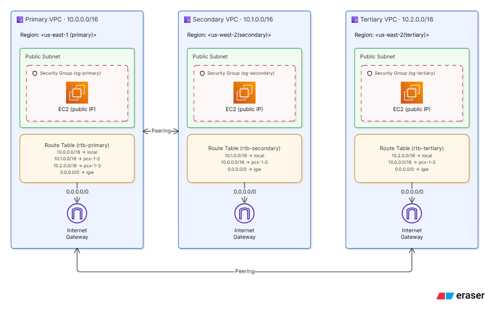

Primary peers directly with both Secondary and Tertiary. Peering is **not transitive** — Secondary and Tertiary cannot reach each other without a direct peering connection between them (visible above: each route table only lists a route to the VPC it directly peers with).

## Components Provisioned

**Per region (×3):**
- VPC with DNS support/hostnames enabled
- Public subnet with auto-assigned public IPs
- Internet Gateway
- Route table (default route to IGW + peering routes)
- Security group (SSH from `0.0.0.0/0`; ICMP and TCP from peered CIDRs)
- EC2 instance (t2.micro, Amazon Linux 2)

**Cross-region:**
- VPC Peering: Primary ↔ Secondary
- VPC Peering: Primary ↔ Tertiary
- Peering accepters with auto-accept enabled
- Bidirectional routes for each peering connection

## Provider Configuration

Three aliased AWS provider blocks (`primary`, `secondary`, `tertiary`), each pointing to the same shared credentials profile but a different region:

```hcl
provider "aws" {
  region                    = var.primary
  shared_config_files       = ["~/.aws/config"]
  shared_credentials_files  = ["~/.aws/credentials"]
  profile                   = "Vscode-TERRAFORM"
  alias                     = "primary"
}
```

Every resource explicitly sets `provider = aws.<alias>` — there is no default (unaliased) provider block, so any resource missing this argument will fail at plan time.

## Prerequisites

- AWS account with credentials configured under a named profile
- Terraform >= 1.0
- SSH key pair created in each region (same name recommended)

```bash
aws ec2 create-key-pair --key-name vpc-peering-demo --region <primary-region> --query 'KeyMaterial' --output text > vpc-peering-demo-east.pem
aws ec2 create-key-pair --key-name vpc-peering-demo --region <secondary-region> --query 'KeyMaterial' --output text > vpc-peering-demo-west.pem
aws ec2 create-key-pair --key-name vpc-peering-demo --region <tertiary-region> --query 'KeyMaterial' --output text > vpc-peering-demo-east2.pem

chmod 400 *.pem
```

## Setup

```bash
cp terraform.tfvars.example terraform.tfvars
# edit terraform.tfvars with your region and key names

terraform init
terraform plan
terraform apply
```

## Testing Connectivity

```bash
terraform output

ssh -i vpc-peering-demo-east.pem ec2-user@<PRIMARY_PUBLIC_IP>
ping <SECONDARY_PRIVATE_IP>
ping <TERTIARY_PRIVATE_IP>
```

## Proof of Connectivity

**VPC consoles, each region confirming its assigned CIDR block:**

| Primary | Secondary | Tertiary |
|---|---|---|
| 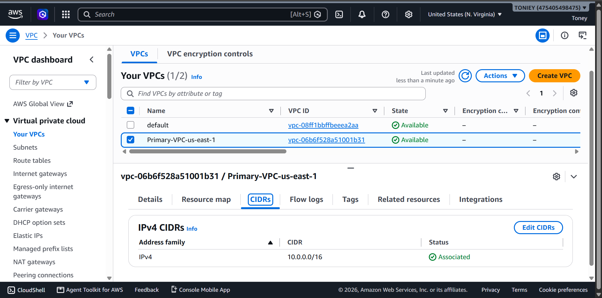 | 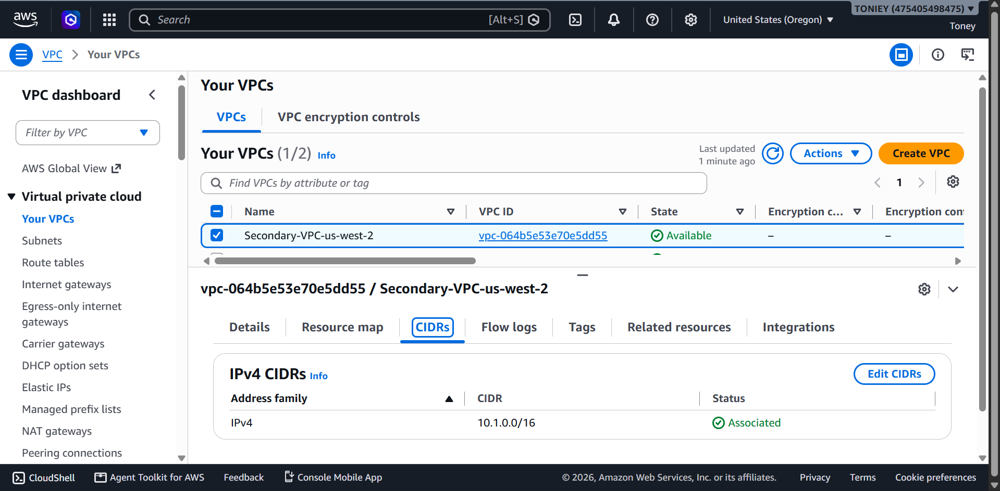 | 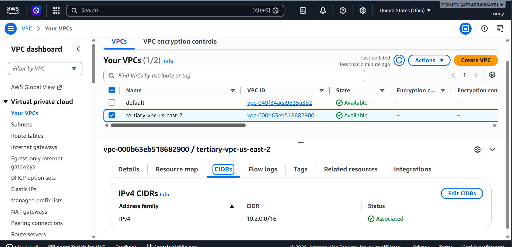 |

**Active peering connections:**

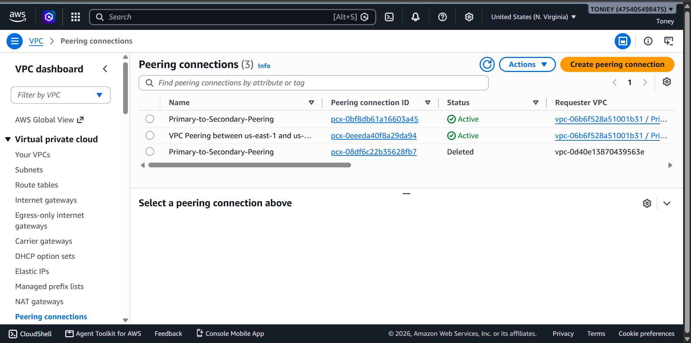
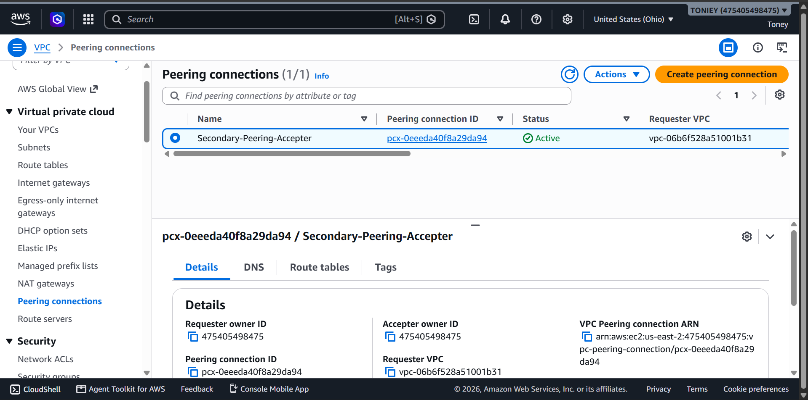
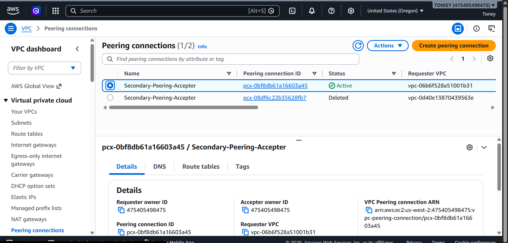

**Route tables, showing peering routes alongside the default internet route:**

| Primary | Secondary | Tertiary |
|---|---|---|
| 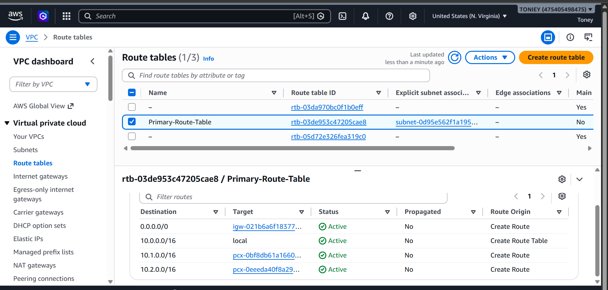 | 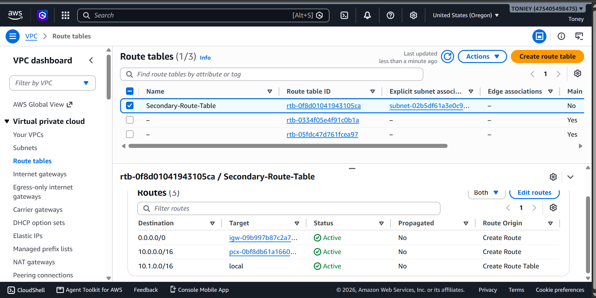 | 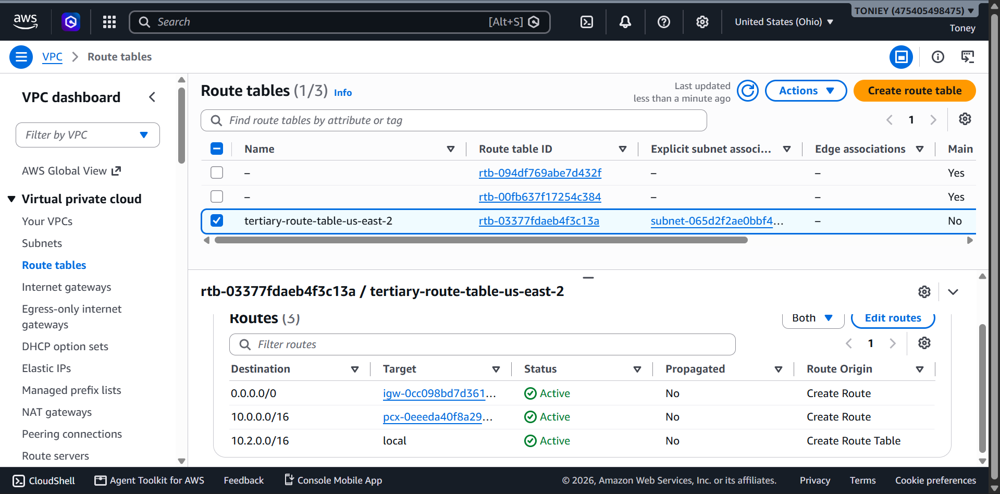 |

**Live ping tests across peered VPCs (private IPs, cross-region):**

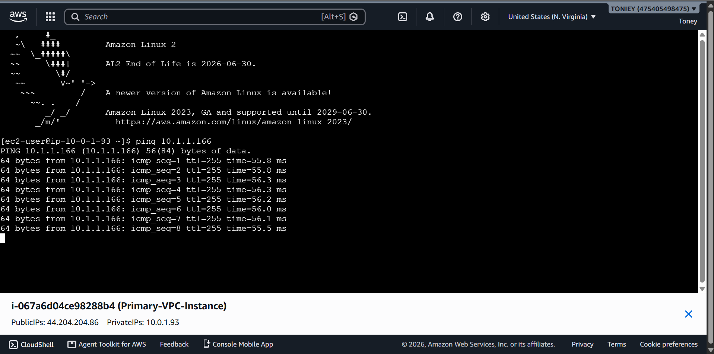
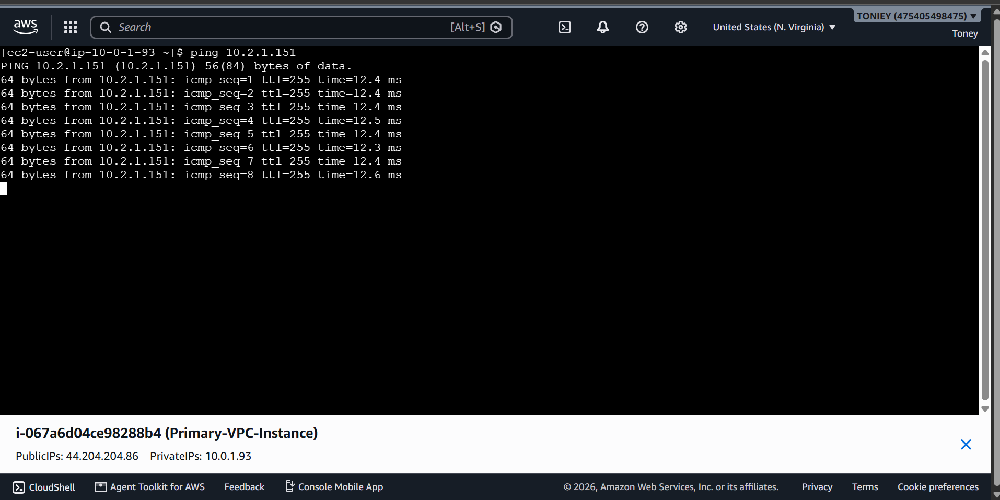

## Design Decisions

**Why VPC peering instead of Transit Gateway:**
With three VPCs, peering is the simplest and cheapest option. A peering connection has no hourly charge; you pay only for data transferred across it. Transit Gateway charges per attachment per hour plus per GB processed, and adds route tables of its own to manage. It becomes the better choice once the number of VPCs grows enough that a full mesh of peering connections is hard to manage, or when transitive routing between every VPC is required.

**Why hub-and-spoke instead of full mesh:**
Connecting every VPC to every other needs n(n−1)/2 peering connections. That is 3 for three VPCs, but 45 for ten. A hub-and-spoke layout, with the primary region as the hub, needs only n−1 and matches a common real-world pattern: a central region hosting shared services that the other regions reach. Secondary and Tertiary are deliberately left unpeered, which also demonstrates that peering is not transitive.

**Why one configuration with provider aliases instead of three separate stacks:**
The peering connections and routes depend on resources in more than one region at once. The requester lives in one region, the accepter in another, and each side's routes reference the other VPC's CIDR. Keeping all three regions in one configuration lets Terraform resolve those cross-region references directly and apply everything in the correct order. Separate stacks would need remote state lookups and multiple applies in the right sequence.

**Why there is no default provider block:**
With a default provider, any resource that forgets `provider =` silently deploys into the default region. Removing it turns that mistake into an immediate plan-time error. Issue 1 below shows exactly this failure mode, caught before anything was created in the wrong place.

**Why a separate accepter resource with auto-accept:**
Cross-region peering can't be accepted from the requester's side: the `auto_accept` argument on `aws_vpc_peering_connection` only works when both VPCs are in the same account and region. The request is created in the primary region with `peer_region` set, and an `aws_vpc_peering_connection_accepter` in the peer region accepts it, so the whole handshake happens in one `apply` with no console step.

**Why routes are added on both sides:**
A peering connection only opens a path; it doesn't route anything. Each VPC's route table needs a route to the other VPC's CIDR pointing at the peering connection. With a route on only one side, packets leave but replies have no way back, which looks like a firewall problem and is easy to misdiagnose. Defining both routes in Terraform alongside the peering connection keeps them in sync.

**Why non-overlapping CIDR blocks:**
AWS will not peer VPCs whose CIDR ranges overlap, and overlapping ranges would make routing ambiguous even if it did. Each region gets a distinct block, as shown in the VPC screenshots, so every private IP maps to exactly one VPC.

**Why security group rules are split by purpose:**
ICMP and TCP, the traffic the peering exists to carry, are opened only to the CIDR blocks of the peered VPCs, so instances reach each other privately without exposing those ports to the internet. SSH is open to `0.0.0.0/0` so each instance can be logged into directly from any network during testing, without hardcoding a home IP that changes. This is a deliberate trade-off for a short-lived test environment, not a production setting: the instances are destroyed after testing, and key-pair authentication is still required. In production, SSH would be restricted to a known IP range or removed entirely in favour of SSM Session Manager.

**Why public subnets and t2.micro instances instead of private subnets with NAT:**
The goal is to prove cross-region private connectivity, not to build a production network. Public subnets let each instance be reached over SSH directly for testing, and avoid NAT Gateway charges in three regions. t2.micro keeps the instances within the free tier.

## Issues Hit and Fixed During Build

**1. `InvalidClientTokenId` on `terraform plan`**
Surface error pointed at AWS credentials, but the root cause was structural: four tertiary-region resources (`aws_vpc.tertiary_vpc`, `aws_subnet.tertiary_subnet_vpc`, `aws_internet_gateway.tertiary_igw`, `aws_route_table.tertiary_rt`) were missing `provider = aws.tertiary`. Without it, Terraform fell back to a default provider that doesn't exist in this config, which surfaced as a bad STS call. Fix: explicit `provider =` on every resource, no exceptions.

**2. Tertiary instance had no public IP**
`aws_subnet.tertiary_subnet_vpc` was missing `map_public_ip_on_launch = true` (present on primary/secondary subnets, omitted here). Fix: added the argument. Note this only applies to new launches — an existing instance needs to be tainted/recreated, or given a manual Elastic IP, to pick up the change.

## Known Limitations

- VPC peering is not transitive — Secondary ↔ Tertiary needs its own peering connection if required
- No NAT Gateway — instances rely on public IPs, not a private-subnet + NAT pattern
- SSH (port 22) is open to `0.0.0.0/0` for testing convenience. Restrict it to your own IP (`curl ifconfig.me`) or replace SSH with SSM Session Manager before running this anywhere long-lived
- Max 125 peering connections per VPC (AWS limit; the default quota is 50 and must be raised to reach 125)
- Cross-region peering traffic is billed as inter-region data transfer

## Cleanup

```bash
terraform destroy
```

Removes all VPCs, subnets, EC2 instances, peering connections, route tables, and IGWs across all three regions.
